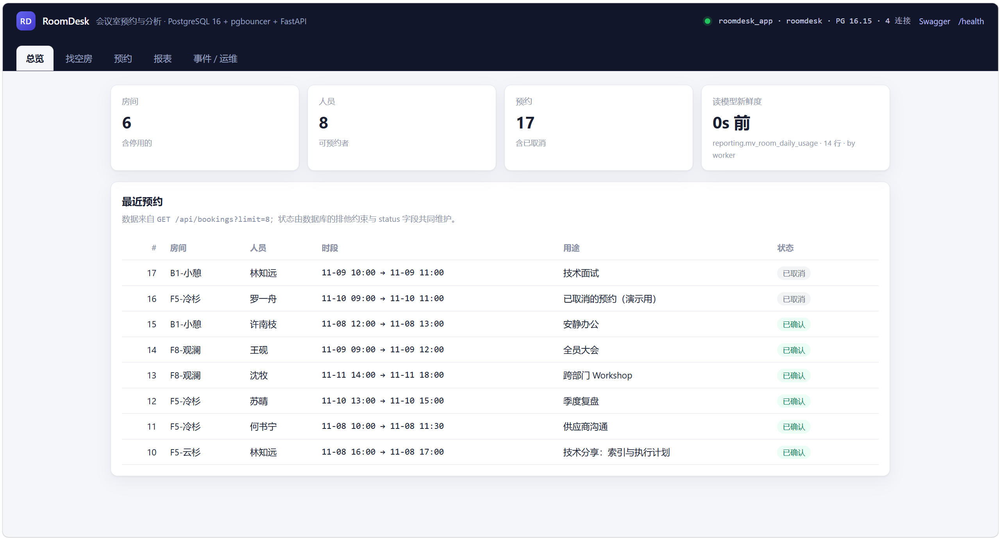

# RoomDesk · 会议室预约与分析平台

一个**把 PostgreSQL 16 和 Docker Compose 当成架构主体**的实习项目：
业务很小（3 张表），但数据链路、权限模型、读写分离思路、事件管道都是生产形态。



> 上面是 `http://localhost:8000/ui/` 的总览页：房间 / 人员 / 预约计数、读模型新鲜度
> （物化视图「刷新于 0 秒前 · 14 行 · by worker」），以及最近预约列表。
> 顶栏那行是 `/health` 的实时回显 —— `roomdesk_app`（最小权限角色）+ PG 16.15 + 当前连接数。
> 前端还有「找空房 / 预约 / 报表 / 事件·运维」四个页签，零依赖、无构建。

```
                       ┌──────────────────────────┐
   浏览器 / curl ─────▶│  api (FastAPI, 非 root)  │
                       │  uvicorn --workers 2     │
                       └───────┬──────────┬───────┘
                               │          │
                    ┌──────────▼───┐      │
                    │  pgbouncer   │      │
                    │  事务池 6432 │      │
                    └──────────┬───┘      │
                               │          │
                       ┌───────▼──────────▼───────┐      ┌──────────────┐
                       │   PostgreSQL 16  db:5432 │◀─────│   worker     │
                       │   roomdesk / reporting   │      │ LISTEN/NOTIFY│
                       └──────────┬───────────────┘      └──────────────┘
                                  │
                       ┌──────────▼───────────────┐
                       │ migrator（一次性容器）   │
                       │ bootstrap → 迁移 → seed  │
                       └──────────────────────────┘
```

## 1. 30 秒启动

```bash
docker compose up -d --build      # 或 make up / pwsh ./task.ps1 up
docker compose ps                 # db / pgbouncer / api 必须 healthy，worker 在跑
```

| 入口 | 地址 | 说明 |
| --- | --- | --- |
| **前端界面** | http://localhost:8000/ui/ | 总览 / 找空房 / 预约 / 报表 / 事件·运维，纯静态零依赖 |
| API 文档 | http://localhost:8000/docs | Swagger，可直接点着调 |
| 健康检查 | http://localhost:8000/health | 回显 `db_user`，能看出走的是哪个角色 |
| 运维面板 | http://localhost:8000/api/ops/db | `pg_stat_activity` + `pg_stat_statements` + 关系体积 |
| 事件流 | http://localhost:8000/api/ops/notifications | worker 通过 LISTEN/NOTIFY 落库的事件 |
| Adminer | http://localhost:8080 | Server=`db`，User=`roomdesk_app`，DB=`roomdesk` |
| 连接池 | `make pools` | `SHOW POOLS` / `SHOW STATS` |

> 访问 `http://localhost:8000/` 会 307 跳到 `/ui/`；`/docs` 只是接口文档，不是页面。
> 前端是 `app/static/` 下的三件套（`index.html` / `app.js` / `style.css`），
> 由 FastAPI 的 `StaticFiles` 直接托管，**没有 Node、没有构建步骤**。

> 首次构建如果卡在 `load metadata ... auth.docker.io`，先 `make pull`（或双击 `prepull.cmd`）预拉基础镜像。

**完整流程**（拉基础镜像 → 构建 → 编排 → 验证 → 测试 → 打开前端 → 排障表）见
[docs/STARTUP.md](docs/STARTUP.md)，每一步都写了"正常应该看到什么"。

## 2. 这个项目用到的 PostgreSQL 能力

| 特性 | 在哪儿 | 为什么这么用 |
| --- | --- | --- |
| **范围类型 `tstzrange`** | `0001_schema.sql`：`bookings.period` | 区间是一个值，能直接参与 `&&` 判断和 GiST 索引 |
| **GiST + 排他约束** | `bookings_no_overlap` | 同一房间时段重叠**由数据库拒绝**，并发下也只能成功一个，应用层零判重逻辑 |
| **部分索引/部分约束** | `WHERE status='confirmed'` | 取消即脱离约束 → 时段自动释放，不用写删除逻辑 |
| **幂等键** | `bookings_idem_uniq`（部分唯一索引） | 用户连点两下只产生一条预约 |
| **JSONB + GIN** | `rooms.equipment`，`?&` 判「设备全具备」 | 半结构化属性免建关联表 |
| **窗口函数** | `app/repositories/reports.py` | 排名 / 占比 / 累计一次扫描算完 |
| **CTE + `generate_series`** | `peak_hours` 查询 | 造 0~23 点时间轴骨架，没预约的小时也出现在结果里 |
| **物化视图 + `REFRESH ... CONCURRENTLY`** | `reporting.mv_room_daily_usage` | 报表读预聚合结果；刷新时不阻塞读 |
| **分区表** | `booking_events` 按月 RANGE | 审计日志只增不改；`tableoid::regclass` 能看出落在哪个分区 |
| **触发器 + `pg_notify`** | `log_booking_event()` / `notify_booking_event()` | 审计与通知和业务写入同事务，不会漏记 |
| **`LISTEN/NOTIFY`** | `worker/consumer.py` | 独立容器消费事件，落 `notifications` 表 |
| **角色 + 最小权限** | `roomdesk_migrator` / `_app` / `_reader` | 应用**不能 DDL**；报表角色只读 |
| **`search_path` 放角色上** | `ALTER ROLE ... SET search_path` | 走连接池或直连行为一致，SQL 里不用写 schema 前缀 |
| **默认权限** | `ALTER DEFAULT PRIVILEGES` | 以后新增的表自动授权，不用每次补 GRANT |
| **`SECURITY DEFINER`** | `ensure_month_partition()` | 应用能建月度分区，但拿不到 DDL 权限 |
| **`pg_stat_statements`** | `/api/ops/db` | 按 SQL 指纹看谁最耗时 |
| **预定义角色 `pg_read_all_stats`** | `bootstrap.sql` | 否则别人的语句在 `pg_stat_statements` 里显示 `<insufficient privilege>` |
| **`EXPLAIN (ANALYZE, BUFFERS)`** | `scripts/explain_lab.sql` | 把「读执行计划」变成日常动作 |

## 3. 这个项目用到的 Docker / Compose 能力

| 能力 | 在哪儿 | 为什么这么用 |
| --- | --- | --- |
| **一次性初始化容器** | `migrator` + `depends_on: service_completed_successfully` | DDL 从应用启动路径里摘出来；迁移失败就**不启动 API** |
| **健康检查做启动顺序** | `db`/`pgbouncer` 用 `pg_isready`、`api` 打 `/health` | 不靠 `sleep`；`api` 的 `/health` 会真的查库，库挂了就 unhealthy |
| **多阶段构建** | `app/Dockerfile`（builder → runtime） | 依赖装进独立 venv，最终镜像不带构建残留 |
| **非 root 运行** | `api` / `worker` 镜像 `USER app` | 容器逃逸第一道墙 |
| **自建镜像** | `pgbouncer/Dockerfile` | alpine + pgbouncer + `tini`，entrypoint 从环境变量生成 `userlist.txt` |
| **profiles** | `backup`（`--profile ops`） | 默认不启动，需要时再开 |
| **命名卷 + 绑定挂载** | `pgdata` 卷、`./db ./scripts ./tests` 只读挂载 | 数据持久化 vs 代码热更新分开 |
| **服务间网络隔离** | `pgbouncer` 只 `expose: 6432`，不映射宿主 | 数据库端口不直接暴露给外面 |
| **日志轮转** | `x-logging` 锚点（`max-size` / `max-file`） | 多个服务共用一段 YAML 配置 |
| **资源限制** | `deploy.resources.limits.memory` | 防止一个容器吃满内存 |
| **优雅停机** | `stop_grace_period` | 让 uvicorn 把 in-flight 请求处理完 |
| **`shm_size`** | `db: 256mb` | 容器默认 `/dev/shm` 太小，并行查询会踩坑 |
| **`$$` 转义** | healthcheck 里的 `$${POSTGRES_USER}` | 不让宿主先替换掉变量 |

## 4. 目录

```
roomdesk/
├── docker-compose.yml        8 个服务（1 个一次性 migrator、2 个 profile：ops / test）
├── .env.example              所有可调参数（端口、密码、池大小、刷新间隔、pip 源）
├── Makefile / task.ps1       两套命令入口（Git Bash / PowerShell）
├── prepull.cmd               预拉基础镜像
├── db/
│   ├── bootstrap.sql         超级用户：扩展 / 角色 / schema / 权限（幂等）
│   ├── migrations/           0001~0006，每个一个事务，记录进 schema_migrations
│   └── seed/seed.sql         演示数据（幂等）
├── pgbouncer/                自建镜像：pgbouncer.ini + entrypoint.sh + Dockerfile
├── app/
│   ├── Dockerfile            5 个阶段：base / deps-runtime / deps-dev / runtime / dev
│   ├── main.py               应用装配 + 异常 → HTTP 映射 + 托管 /ui 静态前端
│   ├── static/               前端三件套（index.html / app.js / style.css，零依赖）
│   ├── config.py  db.py      环境配置；连接池（prepare_threshold=None）+ autocommit 连接
│   ├── errors.py             领域异常（仓储层不认识 HTTP）
│   ├── repositories/         **所有 SQL 都在这里**
│   └── routers/              只做参数校验和调度
├── worker/                   独立镜像（只装 psycopg）+ consumer.py
├── tests/test_api.py         17 个用例：约束/并发/幂等/权限/报表/事件链路
├── docs/
│   ├── STARTUP.md            **从拉镜像到打开前端的完整启动流程**
│   ├── ARCHITECTURE.md       每个 PostgreSQL / Docker 特性的代价与取舍
│   ├── PLAN.md               10 天实习计划、验收标准、答辩题库
│   ├── LOCAL-WITHOUT-DOCKER.md   不用 Docker 怎么开工
│   └── images/ui-overview.png    界面截图（README 用）
└── scripts/
    ├── migrate.sh            bootstrap → 迁移 → seed（容器内外通用）
    ├── backup.sh restore.sh  pg_dump -Fc / pg_restore + 校验与轮转
    └── explain_lab.sql       执行计划、权限矩阵、慢查询、分区剪枝
```

## 5. 5 分钟验证它真的做对了

```bash
# ① 冲突必须由数据库拒绝
curl -s -X POST localhost:8000/api/bookings -H 'Content-Type: application/json' -d '{
 "room_id":1,"staff_id":1,
 "starts_at":"2026-12-02T10:00:00+08:00","ends_at":"2026-12-02T11:00:00+08:00",
 "purpose":"第一段"}' | head -c 200
# 再发一次同样的 → 409，detail 里写着"数据库排他约束拦下"

# ② 走的是 pgbouncer + 最小权限角色
curl -s localhost:8000/health            # db_user=roomdesk_app
make pools                               # roomdesk_app, pool_mode=transaction

# ③ 应用角色不能 DDL
make psql-app
#   roomdesk=> CREATE TABLE roomdesk.x(id int);
#   ERROR: permission denied for schema roomdesk

# ④ 报表读物化视图，带新鲜度
curl -s "localhost:8000/api/reports/utilization?days=30" | head -c 300
# source=reporting.mv_room_daily_usage, freshness.age_seconds

# ⑤ 事件链路：写库 → 触发器 NOTIFY → worker 落库
curl -s "localhost:8000/api/ops/notifications?limit=3"

# ⑥ 全部自动化用例
make test                                 # 17 passed
```

## 6. 常用命令

```bash
make pull         # 预拉基础镜像（规避 BuildKit 拉元数据超时）
make build        # 只构建镜像（含 test 用的 dev 目标），不启动
make images       # 看本项目镜像体积
make up           # 构建 + 启动（含迁移）
make ps           # 容器状态（含 ops profile）
make test         # 用 dev 目标镜像跑 17 个用例（不是 exec api）
make logs         # 全部日志
make logs-worker  # 只看 worker 的 LISTEN / REFRESH
make pools        # pgbouncer SHOW POOLS / SHOW STATS
make psql         # 超级用户（排查用）
make psql-app     # 应用角色（验证最小权限）
make bench        # 执行计划 / 权限矩阵 / 慢查询 / 分区剪枝
make backup       # pg_dump -Fc 到 ./backups
make migrate      # 在宿主机上跑迁移（不用 Docker 时）
make reset        # 删卷重建（数据全丢）
```

Windows PowerShell：`pwsh ./task.ps1 up`、`pwsh ./task.ps1 test`……

### 镜像分四个，按用途选

| 镜像 | 构建目标 | 大小（实测） | 用途 |
| --- | --- | --- | --- |
| `roomdesk-api` | `app/Dockerfile` → `runtime` | 282 MB | 生产 API，**不含 pytest** |
| `roomdesk-test` | `app/Dockerfile` → `dev` | 303 MB | 跑测试 / 调试（带 pytest、httpx） |
| `roomdesk-worker` | `worker/Dockerfile` | 224 MB | 事件消费 + 读模型刷新 |
| `roomdesk-pgbouncer` | `pgbouncer/Dockerfile` | 21.6 MB | 事务连接池 |

两个构建优化：pip 缓存挂载（`--mount=type=cache`）+ 依赖层与源码层分离
（实测**改一行 Python 代码后重建只要 1 秒**）。
全部镜像非 root（uid 1001）。完整流程见 [docs/STARTUP.md](docs/STARTUP.md)。

### 不想开 Docker？本机模式一键跑

```powershell
D:\实习\roomdesk\run-local.cmd              # 自动：拉起 PG → 建库 → 迁移 → 装依赖 → 起 worker + API
D:\实习\roomdesk\run-local.cmd -PreflightOnly   # 只做检查与准备，不启动服务
```

七步预检（工具链 / 数据库进程 / 建库 / 迁移 / 依赖 / 刷读模型 / 起服务）全部幂等，
失败会明确指出原因。细节见 [docs/LOCAL-WITHOUT-DOCKER.md](docs/LOCAL-WITHOUT-DOCKER.md)。

## 7. 数据模型

```sql
rooms(id, name, floor, capacity, equipment jsonb, active)
staff(id, name, email, role)
bookings(id, room_id → rooms, staff_id → staff,
         period tstzrange, purpose, status, tags text[],
         idempotency_key, created_at, cancelled_at,
         EXCLUDE USING gist (room_id WITH =, period WITH &&) WHERE status='confirmed')
booking_events(分区表，按月)              notifications(worker 写入)
reporting.mv_room_daily_usage(房间×天)    reporting.report_state(刷新水位)
```

## 8. 常见坑

1. **`bootstrap.sql` 只处理集群级对象**，表结构全在 `db/migrations/`。
   改 schema 就新增迁移文件，不要改已执行过的迁移。
2. **事务池不能有预编译语句**：`app/db.py` 里 `prepare_threshold=None`，否则 pgbouncer
   复用会话时会串味。
3. **`LISTEN` 不能走池子**：所以 worker 直连 `db:5432`。
4. **`REFRESH MATERIALIZED VIEW CONCURRENTLY` 不能进事务块**：用
   `db.autocommit_connection()`；并且需要物化视图上的**唯一索引**。
5. **`REFRESH` 权限只跟 owner 走**，没有对应的 GRANT —— 所以物化视图的 owner
   转给了 `roomdesk_app`，`reporting` schema 单独给了 `CREATE`（业务 schema 没给）。
6. **SQL 里的 `%` 要写成 `%%`**：psycopg 把 `%` 当占位符，`ILIKE '%x%'` 会报
   `only '%s','%b','%t' are allowed as placeholders`。
7. **`pg_stat_statements` 看不到别人的语句** → 授予 `pg_read_all_stats`。
8. **容器里以非 root 跑 pytest** 写不了 `.pytest_cache` → `make test` 带 `-p no:cacheprovider`。
9. **`docker compose exec api pytest` 会报 `No module named pytest`** —— 这是设计如此：
   生产镜像（`runtime` 目标）不带测试依赖。跑测试用 `make test`（`dev` 目标镜像 + `test` 服务）。
10. **改代码后不必 `--no-cache`**：依赖层命中缓存，实测增量重建 1 秒；
    只有改 `requirements*.txt` 才会重装依赖（冷构建 api 约 5 分钟、worker 约 2 分钟，瓶颈是 pip 下载，
    可在 `.env` 里设 `PIP_INDEX_URL` 换源）。

更细的机制与权衡见 [docs/ARCHITECTURE.md](docs/ARCHITECTURE.md)；
**完整启动流程**见 [docs/STARTUP.md](docs/STARTUP.md)；
实习节奏与验收标准见 [docs/PLAN.md](docs/PLAN.md)；
不装 Docker 怎么开工见 [docs/LOCAL-WITHOUT-DOCKER.md](docs/LOCAL-WITHOUT-DOCKER.md)。

## 9. 下一步（按价值排序）

1. 前端周视图（把可用时段画出来，演示效果提升最大）
2. 重复预约规则（`recurrences` 表 + 单事务展开，撞约束整体回滚）
3. 读副本：逻辑复制 + 报表走只读实例（`roomdesk_reader` 已经是只读角色，正好接上）
4. `pg_cron` 或独立 cron 容器：每月预建分区、每小时 `REFRESH`、监控 DEFAULT 分区行数
5. 可观测：`postgres_exporter` + Grafana，看连接数 / QPS / 慢查询
